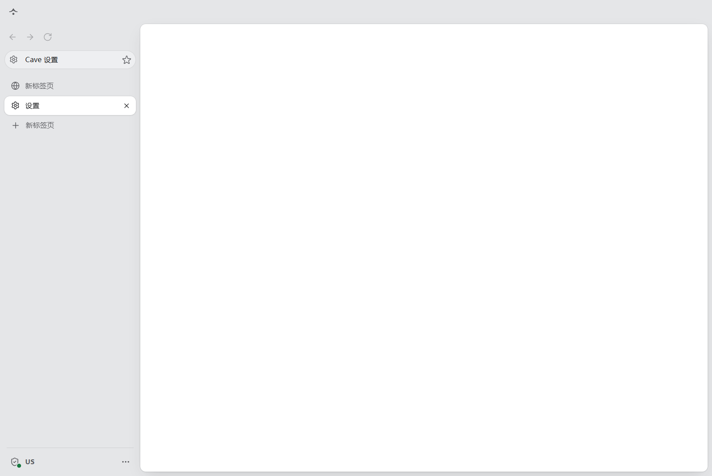
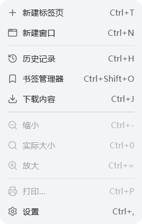

# Windows 真机验收 — 2026-11-13

本次结果不是“全部通过”。**默认继续跟随系统路由/TUN；原始 LA-9929-US-Home 在当前宿主 TUN 串联路径核对失败并保持关闭。** 新增的“独立连接节点（绕过宿主机 TUN）”是默认关闭的可选功能，不能算作默认路径已修复。开启后，同一原始节点通过 US 核对，13/13 自检通过。订阅链接、节点密钥和私有配置没有提交。

## 环境与方法

- Windows 11 专业版 10.0.26200，x64；Node 24.22.0，npm 11.19.1。
- Electron 45.3.0 / Chromium 156.0.8078.96；固定 mihomo v1.19.34 Windows x64，经仓库 SHA-256 校验。
- 宿主 FlClash TUN 开启（Meta Tunnel），宿主代理端口 7890；宿主内核 v1.19.32。未修改宿主的路由、代理或安全设置。
- 实际使用用户指定的 LA-9929-US-Home，预期 US。原始节点参数保留，只在生成的 runtime.yaml 选择组中改写内部节点名。
- 源码和包均通过 startWorld() 启动。用户授权过前台操作，后按 Esc 停止电脑控制；之后只做后台/CDP 与源码验证，不再操作原生界面。
- 初始基线 50d3a45；远端重建为 bfe8806 后确认差异仅为 CI，PR 基于新的 main。

## 结果

| 项目 | 结果 | 证据 / 限制 |
| --- | --- | --- |
| npm ci、固定内核下载校验、类型检查/单元测试 | 通过 | 最终 125 项：124 通过，1 项按 Windows 条件跳过，0 失败。 |
| Windows x64 安装包与 zip 构建 | 通过 | npm run dist -- --config.electronDist=node_modules/electron/dist。使用 npm 已安装并校验的同版本 Electron，避免重复下载。 |
| NSIS 安装和启动 | 通过 / 备注 | 早期本地构建在当前用户目录完成安装，安装后的 Anyu.exe 已打开；最终包随后重新生成，未重复做原生安装向导。 |
| SmartScreen 更多信息→仍要运行 | 跳过 | 本地产出安装器没有触发 SmartScreen，未验证该分支。 |
| zip 直接运行 | 通过 | 最终 zip 解压后启动其中的 Anyu.exe；两项 Windows smoke 测试通过，包括开关切换和杀内核。 |
| 全新环境进入代理/节点页 | 修复后通过 | 原来停在空白页；现在无节点时打开设置节点页。目标分类保存在 ShellState，避免初始化 IPC 事件丢失。当前 UI 分类名是“代理”。 |
| 红色关闭状态、未导入节点原因、阻止导航 | 通过 | 空目录启动；访问 example.com 只显示状态卡并保留待打开网址，本地 fixture 与 SOCKS 节点都未收到请求；出口检查失败。 |
| 原始节点 + 默认系统 TUN 路由 | 失败 / 保持关闭通过 | 出口核对 ERR_CONNECTION_CLOSED，core.log 显示到节点上游超时；12/13，不放行。不能报告为默认联网通过。 |
| 默认路径诊断 | 备注 | 原始订阅、宿主 FlClash 同名节点和 Anyu 生成节点的协议字段一致。另用独立核心把该节点显式串联到宿主 HTTP 代理也超时；故障不局限于 Anyu 窗口层，根因尚未确定。 |
| 新功能：独立连接节点 | 通过 | 默认 false。开启后自动选择 OS 有效出站接口；同一原名节点得到 US，13/13。关闭移除 interface-name，回到系统路由。没有改写订阅。 |
| 开关切换、手动暂停、国家不符 | 通过 | 变更前关闸并停内核；已暂停时改开关仍暂停。真实 US 出口临时要求 JP 后保持关闭，改回 US 才重新放行。 |
| 杀内核、页面失败、重启重检 | 通过 / 备注 | taskkill /PID /F 结束单个测试内核。独立出站真实节点：约 152ms 关闭、页面 ERR_CONNECTION_RESET、约 4.86s 核对后恢复。默认模式本地 fixture 约 0.1s 关闭、约 1.3s 恢复。独立模式多出路由查询耗时，未达到约 1 秒的恢复时长。 |
| 故障间隙无外网连接、无 DNS 泄漏的连续抓包 | 未完成 | PktMon 报“拒绝访问”。TCP 快照只见浏览器本机连接；快照不是连续 TCP/UDP/DNS 证据，不能据此证明整个间隙零泄漏。没有修改安全设置或提权。 |
| 随机端口、不占用 7890/9090 | 通过 | runtime.yaml 监听均为 127.0.0.1 随机端口，控制器随机；宿主 FlClash 保持运行且宿主代理访问核对端点成功。 |
| Windows 平台通行密钥 | 通过（用户协助） | WebAuthn.io 平台可用性返回 true；网页注册成功。用户确认亲眼看到 Windows 验证器并手动完成。未自动操作 PIN/认证对话框。 |
| Windows 系统窗口按钮 | 通过 | 原生最小化、最大化、关闭位于右上角。 |
| 应用图标、侧栏单色标志 | 已修复 / 有限目测 | 从已有 icns 导出 ico/png，Windows 安装包和窗口显式配置图标；侧栏标志为 currentColor SVG，pointer-events:none。CDP 截图已检查；最终安装包图标未再次经桌面快捷方式目测。 |
| 菜单瞬显、退出淡出 | 通过（结构/运行时） | 菜单和阴影打开 opacity=1、transition=0s，菜单动画数 0；退出 opacity transition=0.14s、transform=none，最终 opacity=0。Windows 阴影窗口只首次显示透明 1px 窗口，避免每次原生 show 入场动画。 |
| host UA / UA-CH / Worker | 部分通过 | 主线程和 Worker UA 无 Electron，Windows/Win32 一致；非零调试端口下 webdriver=false，品牌有 Google Chrome。宿主 Chrome 为 157.0.8103.52，与 Anyu 156 不同主版本，因此同版本 Chrome 对照未完成。 |
| 时区和语言 | 部分通过 | 本地 fixture 使用不同于宿主的 de-DE / Etc/GMT+8，主线程与 Worker 自检一致；未修改 Windows 系统语言和时区。 |
| 地理位置、额外字体基线、外部 WebRTC 观察页 | 跳过 | 未完成对应真机页面/新增字体流程；自检 WebRTC 无裸 UDP、候选 0 个仅作为引擎自检证据。 |
| 下载、页内查找 | 通过（本地节点） | 真实 Chromium + 本地 SOCKS fixture；下载进度和完成状态、查找结果计数与切换通过。 |
| 缩放 | 通过（前台本地节点） | 跨标签、跨窗口、重启持久化、侧栏重置及站点清理测试通过。初次后台输入超时，获得前台授权后同一聚焦测试通过。 |
| 剪贴板 | 部分通过 | 两种真实模式均通过“复制报告”取得完整 Unicode 文本；网页写入与后台读取权限流程未另行完成。 |
| PDF 内置查看器 | 失败 / 未修复 | W3C dummy.pdf 出现内置查看器工具栏，但正文空白。内部扩展流的 frame 导航限制是待查方向；未把未充分验证的导航白名单改动混入 PR。 |
| 文件上传、带声音视频、OAuth 弹窗完整登录、打印 | 跳过 | 用户停止电脑控制后未继续原生文件/认证/打印及听音流程。未把模拟弹窗当作 OAuth 登录完成。 |
| 换节点确认、网站数据清理/重置、跨机器便携 | 未完成 | 无第二台机器；本次未进行完整网站账号与确认框流程。 |

## 独立出站开关的边界

关闭是默认行为，保留系统 TUN 路线。开启时只绑定核心的上游套接字，浏览器仍只连本机 SOCKS，所有国家/节点/核心条件照旧核对。找不到可用接口时保持关闭，不自动切回系统 TUN。以太网/Wi-Fi/移动接口按 OS 默认路由与接口度量选择；物理接口优先，也支持虚拟机的虚拟以太网。只有 TUN/PPP 等不支持的默认接口时，本功能不会放行。路由变化后仍需重新核对/重启核心；没有后台路由监控。

## 默认系统/TUN 模式自检全文

```text
Cave 自检报告  2026-11-13T12:10:16.716Z
闸门：外网已关闭（出口核对请求失败：net::ERR_CONNECTION_CLOSED）
配置：时区 Asia/Shanghai，语言 zh-CN, zh，出口国家 US，平台 host，独立连接节点（Windows）false
最近出口：无
通过 12/13
✓ 1. 代理核心在运行 — Cave 自己拉起的核心，控制器应答正常
✓ 2. 浏览器只走 Cave 的本机端口 — SOCKS5 127.0.0.1:63327，回环地址也不绕过
✓ 3. 浏览器不做本地 DNS — 本地解析被拒绝，主机名交给代理在远端解析
✓ 4. 时区等于配置 — 页面 Asia/Shanghai，Worker Asia/Shanghai
✓ 5. 语言等于配置 — 页面 zh-CN, zh；Worker zh-CN, zh
✓ 6. 代理不可用时连接会失败 — 没有备用出口：端口背后没有核心，连接就失败
✓ 7. QUIC 已关闭 — --disable-quic
✓ 8. IPv6 已关闭 — --disable-ipv6，核心 ipv6: false
✓ 9. WebRTC 不走裸 UDP — disable_non_proxied_udp，本地候选 0 个、无 IP 地址
✓ 10. 没有直连，私网被拒绝 — 闸门关闭：除出口核对外 MATCH,REJECT；无 DIRECT
✗ 11. 出口国家等于配置 — 出口核对请求失败：net::ERR_CONNECTION_CLOSED
✓ 12. UA 与客户端提示一致 — Mozilla/5.0 (Windows NT 10.0; Win64; x64) AppleWebKit/537.36 (KHTML, like Gecko) Chrome/156.0.0.0 Safari/537.36；品牌 Not:A-Brand / Chromium / Google Chrome；平台 Windows / Win32
✓ 13. 呈现的平台与本机一致 — Windows
```

## 开启独立连接节点后的自检全文

```text
Cave 自检报告  2026-11-13T12:10:21.203Z
闸门：外网已放行（出口 US 与配置一致）
配置：时区 Asia/Shanghai，语言 zh-CN, zh，出口国家 US，平台 host，独立连接节点（Windows）true
最近出口：US 98.236.136.107
通过 13/13
✓ 1. 代理核心在运行 — Cave 自己拉起的核心，控制器应答正常
✓ 2. 浏览器只走 Cave 的本机端口 — SOCKS5 127.0.0.1:63327，回环地址也不绕过
✓ 3. 浏览器不做本地 DNS — 本地解析被拒绝，主机名交给代理在远端解析
✓ 4. 时区等于配置 — 页面 Asia/Shanghai，Worker Asia/Shanghai
✓ 5. 语言等于配置 — 页面 zh-CN, zh；Worker zh-CN, zh
✓ 6. 代理不可用时连接会失败 — 没有备用出口：端口背后没有核心，连接就失败
✓ 7. QUIC 已关闭 — --disable-quic
✓ 8. IPv6 已关闭 — --disable-ipv6，核心 ipv6: false
✓ 9. WebRTC 不走裸 UDP — disable_non_proxied_udp，本地候选 0 个、无 IP 地址
✓ 10. 没有直连，私网被拒绝 — 规则末尾 MATCH,PROXY；回环与私网 REJECT；无 DIRECT
✓ 11. 出口国家等于配置 — 最近一次：US（98.236.136.107，节点 LA-9929-US-Home），配置 US
✓ 12. UA 与客户端提示一致 — Mozilla/5.0 (Windows NT 10.0; Win64; x64) AppleWebKit/537.36 (KHTML, like Gecko) Chrome/156.0.0.0 Safari/537.36；品牌 Not:A-Brand / Chromium / Google Chrome；平台 Windows / Win32
✓ 13. 呈现的平台与本机一致 — Windows
```

## core.log 关键片段

失败片段属于默认 TUN 路线。warning 日志级别不会写一条“国家核对成功”；放行证据来自上面的实际自检和闸门状态。下面的重新启动记录也不单独代表放行。

```text
time="2026-11-13T19:57:22.600889900+08:00" level=warning msg="[TCP] dial PROXY (match InName/probe) 127.0.0.1:58816 --> www.cloudflare.com:443 error: 154.9.251.80:8443 connect error: context deadline exceeded"
time="2026-11-13T19:57:27.602598900+08:00" level=warning msg="[TCP] dial PROXY (match InName/probe) 127.0.0.1:52449 --> www.cloudflare.com:443 error: 154.9.251.80:8443 connect error: context deadline exceeded"
time="2026-11-13T20:10:04.782144800+08:00" level=warning msg="[TCP] dial PROXY (match InName/probe) 127.0.0.1:55720 --> www.cloudflare.com:443 error: 154.9.251.80:8443 connect error: context deadline exceeded"
time="2026-11-13T19:59:28.417735600+08:00" level=info msg="Start initial configuration in progress"
time="2026-11-13T19:59:28.420873200+08:00" level=info msg="Initial configuration complete, total time: 3ms"
time="2026-11-13T20:09:59.674666300+08:00" level=info msg="Start initial configuration in progress"
time="2026-11-13T20:09:59.682365900+08:00" level=info msg="Initial configuration complete, total time: 7ms"
time="2026-11-13T20:10:18.872166700+08:00" level=info msg="Start initial configuration in progress"
time="2026-11-13T20:10:18.876433500+08:00" level=info msg="Initial configuration complete, total time: 4ms"
```

## 闸门核心改动逐行说明

src/main/gate.ts、src/main/network.ts 没有改动。以下是 gatekeeper.ts 与 proxy/config.ts 的全部变更行；放行判定、代际校验、节点一致性校验和 REJECT/MATCH 规则均未放宽。

| 位置 | 改动 | 理由 |
| --- | --- | --- |
| src/main/gatekeeper.ts:29 | 新增 `resolveOutboundInterface?: () => Promise<string \| undefined>;` | 声明可选接口绑定；默认未启用时不改变系统/TUN 路由。 |
| src/main/gatekeeper.ts:42 | 新增 `private outboundInterface: string \| undefined;` | 只保存本次内核启动解析出的接口，不把本机接口写入便携 profile 或订阅。 |
| src/main/gatekeeper.ts:228 | 新增 `outboundInterface: this.outboundInterface,` | 把本次启动的可选接口传入内核配置；原有代理监听、REJECT 和放行规则不变。 |
| src/main/gatekeeper.ts 原 262 行 | 删除/移动 `await this.writeConfig();` | 将配置写入移到同一启动错误处理内，失败保持关闭。 |
| src/main/gatekeeper.ts:266 | 新增 `// Resolve again after a core restart; a stale interface must not select a host TUN.` | 说明重新启动时重新读取路由，避免使用过期网卡。 |
| src/main/gatekeeper.ts:267 | 新增 `this.outboundInterface = await this.o.resolveOutboundInterface?.();` | 仅开关开启时选择接口；失败抛出，进入原有 core-down 分支，不回退到宿主 TUN。关闭开关时得到 undefined。 |
| src/main/gatekeeper.ts:268 | 新增 `await this.writeConfig();` | 移入 try：路由解析/配置写入失败与内核启动失败都保持关闭，不继续启动。 |
| src/main/proxy/config.ts:23 | 新增 `/** OS-resolved uplink for the core's encrypted upstream sockets, not browser traffic. */` | 声明可选接口绑定；默认未启用时不改变系统/TUN 路由。 |
| src/main/proxy/config.ts:24 | 新增 `outboundInterface?: string;` | 声明可选接口绑定；默认未启用时不改变系统/TUN 路由。 |
| src/main/proxy/config.ts:42 | 新增 `...(i.outboundInterface ? { 'interface-name': i.outboundInterface } : {}),` | 仅存在已解析接口时生成 mihomo 的出站绑定。未开启时不生成该键；不增加 DIRECT，不改变闸门规则。 |

## 构建产物 SHA-256

- Anyu-0.1.0-win-x64.exe: `9051cb86608e579747b3ad21101ced121926f5fc4632d8699830d16c612bb210`
- Anyu-0.1.0-win-x64.zip: `9c338a346047bc459c647390f0a829194dd6c128f67d4c3bfc3fc75d23e23690`

## 截图

CDP 只捕获 shell/overlay 自己的绘制区域，不含其他 WebContentsView 和原生窗口按钮；右侧留白是这种捕获方式的结果。





测试结束后检查本工作区及本次安装目录的 Electron / Anyu / cave-core 进程，确认没有遗留；宿主 FlClash 未结束。
